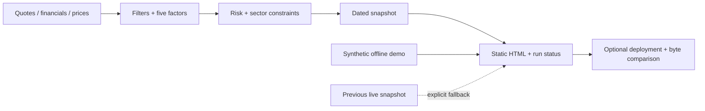

<p align="center"><strong>FREETRADE</strong></p>
<h1 align="center">Explain the score.<br>Trace the data.</h1>
<p align="center">An inspectable A-share research pipeline with honest data states and operational evidence.</p>

<p align="center">
  <a href="README.md">简体中文</a> · <b>English</b> ·
  <a href="https://github.com/eust-w/freetrade/actions/workflows/ci.yml"></a> ·
  <a href="LICENSE">MIT</a>
</p>

## A Dashboard Should Explain More Than a Score


Where did the score come from? What date does the data describe? What happened when a provider failed?

FreeTrade makes these questions visible. Python collects and ranks research candidates, a validated snapshot preserves provenance, and a single HTML page presents the result. The offline demo needs no account, API key, or database.

**This is a rule-based research prototype, not an AI trading bot.** It has no LLM inference, brokerage integration, automated execution, or validated return backtest. Synthetic demo values do not represent real securities. Scores and heuristic price ranges are not investment advice or promises of returns.

## Watch in English or Chinese

Both narration editions include **burned-in Chinese and English subtitles**, bilingual diagrams, and landscape and portrait exports. English narration is a separate audio version, not merely an English title on a Chinese video. Interface screenshots retain the original Chinese UI.

| Narration | Landscape 16:9 | Portrait 9:16 |
| --- | --- | --- |
| English | [Watch / download MP4](https://github.com/eust-w/freetrade/releases/download/v0.1.1/freetrade-en-bilingual-landscape.mp4) | [Download MP4](https://github.com/eust-w/freetrade/releases/download/v0.1.1/freetrade-en-bilingual-portrait.mp4) |
| Chinese | [Watch / download MP4](https://github.com/eust-w/freetrade/releases/download/v0.1.1/freetrade-zh-bilingual-landscape.mp4) | [Download MP4](https://github.com/eust-w/freetrade/releases/download/v0.1.1/freetrade-zh-bilingual-portrait.mp4) |

[Release assets, subtitles, and checksums](https://github.com/eust-w/freetrade/releases/tag/v0.1.1) · [Reproducible media sources](media/README.md)

Narration uses disclosed synthetic system voices. Visuals are original diagrams and demo screenshots; no third-party music is included. [Earlier Chinese-only social posts](media/PUBLISHED.md) are a separate edition.

## Run in One Minute

Python 3.11+ is enough for the offline demo. No third-party packages are required:

```bash
git clone https://github.com/eust-w/freetrade.git
cd freetrade
python3 refresh.py --mode demo
python3 -m http.server 8000 --bind 127.0.0.1 --directory dist
```

Open [localhost:8000](http://127.0.0.1:8000). The dashboard explicitly labels the data as synthetic. The demo UI is currently Chinese; this README and the video provide English explanations.

For live collection:

```bash
python3 -m venv .venv
source .venv/bin/activate
pip install -r requirements.txt

# Example research period: explicitly choose published financial reports.
export FREETRADE_REPORT_PERIOD=20260331
export FREETRADE_ANNUAL_YEAR=2025
python refresh.py --mode live
```

External providers may disconnect, rate-limit, or change fields. Live failure exits by default. `--allow-fallback` explicitly permits a previous successful snapshot, when one exists. Demo data is never used as a live fallback. Cached rendering preserves the original data date.

## What Is Inspectable?

| Component | Implementation |
| --- | --- |
| Five factor groups | Value 16%, growth 22%, quality 17%, momentum 25%, fund flow 20% |
| Candidate selection | Liquidity and financial filters, volatility penalties, sector limits |
| Data provenance | Separate `generated_at`, `data_as_of`, and `mode` |
| Rendering | Validated JSON, escaped output, static HTML and `run.json` |
| Deployment | Opt-in SSH, environment configuration, atomic replacement, content verification |
| Run evidence | Allowlisted summaries of 127 retained legacy logs |



[Architecture](docs/ARCHITECTURE.md) · [Detailed project analysis](docs/PROJECT_ANALYSIS.md) · [Methodology](docs/METHODOLOGY.md) · [Deployment](docs/DEPLOYMENT.md). These detailed engineering documents are currently in Chinese; field names and commands are shared.

## Failures Are Part of the Record

The repository includes sanitized observations from **127 retained logs**, dated **June 15 through September 1, 2026**:

| Observed legacy outcome | Count |
| --- | ---: |
| Successful rendering labeled `live` | 5 |
| Successful rendering labeled `fallback` | 105 |
| No complete success result observed | 17 |
| Logs containing HTTP 200 | 110 |

These overlapping observations are not new benchmark results, a complete scheduling ledger, or evidence of profitability. **HTTP 200 means the page was reachable, not that the market data was fresh.**

[Per-run JSONL](docs/runs/runs.jsonl) · [Summary JSON](docs/runs/summary.json) · [Provenance and redaction](docs/RUN_HISTORY.md)

## Engineering Boundaries

The public version unifies cache formats, separates demo and live snapshots, preserves data dates, removes fixed market claims, configures financial periods, and validates published content. Private server addresses, key paths, raw logs, browser sessions, and raw market CSV files are excluded.

Important limitations remain: unstable upstream interfaces, incomplete historical point-in-time financial data, no exchange calendar, no cache lifetime policy, no scheduler lock, and no fee/slippage-aware return validation. The existing production site is maintained separately and has not been replaced by this release.

## Verify and Contribute

```bash
pip install -r requirements-dev.txt
python -m pytest -q
python -m pip_audit -r requirements.txt
python scripts/verify_site.py http://127.0.0.1:8000 --expected dist/index.html
```

Contributions to provider contracts, point-in-time datasets, trading calendars, cache expiry, backtesting, and visualization are welcome. Read [CONTRIBUTING](CONTRIBUTING.md) and [SECURITY](SECURITY.md) before submitting changes.

Code is licensed under [MIT](LICENSE). Third-party market data remains subject to its providers' terms and is not covered by the code license.

[Author](https://github.com/eust-w) · [Claworkers](https://claworkers.com/)
