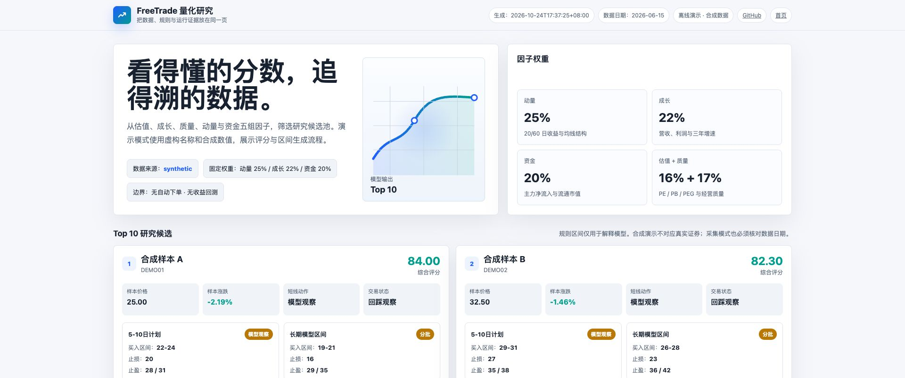
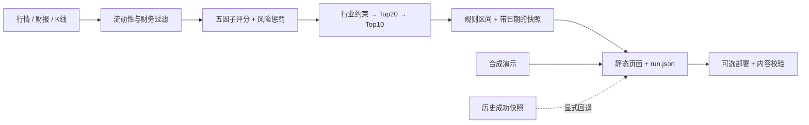
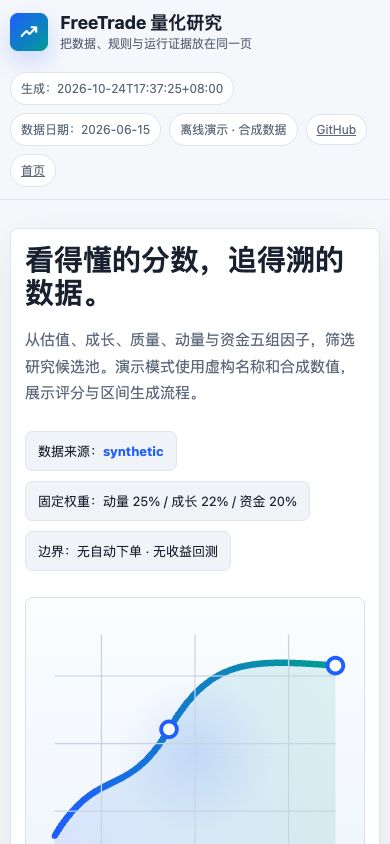

<p align="center"></p>

<p align="center">
  <a href="https://github.com/eust-w/freetrade/actions"></a>
  
  <a href="LICENSE"></a>
  
</p>

<p align="center"><b>一个把 A 股筛选规则、数据状态与运行证据一起公开的研究工具。</b><br>
Explainable A-share research, honest data provenance, and inspectable operations.</p>

<p align="center">
  <a href="#一分钟运行">快速开始</a> ·
  <a href="docs/ARCHITECTURE.md">框架设计</a> ·
  <a href="docs/PROJECT_ANALYSIS.md">项目分析</a> ·
  <a href="docs/RUN_HISTORY.md">运行记录</a> ·
  <a href="docs/DEPLOYMENT.md">部署</a>
</p>

## 先看结果，再看规则



**选股页面不应该只给一个分数。** 它还应该说明：分数如何产生、行情是哪一天的、上游失败后用了什么，以及本次运行究竟完成到哪一步。

FreeTrade 将这些问题放进一个小而完整的流程：Python 采集与计算、显式快照、静态页面、部署校验。默认离线演示无需账号、API Key 或数据库。

| 你能看到什么 | 对应实现 |
| --- | --- |
| 五组因子与固定权重 | 估值 16% · 成长 22% · 质量 17% · 动量 25% · 资金 20% |
| 可检查的筛选逻辑 | 流动性与财务条件、波动惩罚、行业候选数限制 |
| 明确的数据状态 | demo / live / cached / fallback，生成时间与数据日期分开 |
| 能复现的演示 | 虚构证券名称与合成数值，默认完全离线 |
| 可审计的运行记录 | 127 份保留日志的结构化脱敏摘要，包含不完整结果 |
| 简单的交付方式 | 单个 HTML、原子替换、HTTP / 链接 / 内容一致性核验 |

> 这是规则驱动的研究原型，没有 LLM 推理、自动下单或收益回测。演示数据不对应真实证券；评分与价格区间不是投资建议或盈利承诺。

## 一分钟运行

只看演示，使用 Python 3.11+ 即可，无需安装第三方包：

```bash
git clone https://github.com/eust-w/freetrade.git
cd freetrade
python3 refresh.py --mode demo
python3 -m http.server 8000 --bind 127.0.0.1 --directory dist
```

打开 [本地演示](http://127.0.0.1:8000)。页面会明显标注 **离线演示 · 合成数据**。

需要真实采集时：

```bash
python3 -m venv .venv
source .venv/bin/activate
pip install -r requirements.txt

# 示例研究期间，请按实际需要显式选择已公布财报。
export FREETRADE_REPORT_PERIOD=20260331
export FREETRADE_ANNUAL_YEAR=2025
python refresh.py --mode live
```

外部数据源可能限流、断连或改变字段。真实采集失败默认退出；已有成功快照时，可明确启用 `--allow-fallback`。缓存模式不会更新原始数据日期。详见[数据与方法边界](docs/METHODOLOGY.md)。

## 一条完整的数据路径



完整模块职责、公式、异常路径和取舍见[框架设计](docs/ARCHITECTURE.md)。

## 把失败也放出来

本地保留日志覆盖 **2026-06-15 至 2026-09-01**，共 **127 份**：

| 日志观察结果 | 数量 |
| --- | ---: |
| 标记为 live 的渲染成功 | 5 |
| 标记为 fallback 的渲染成功 | 105 |
| 未观察到完整成功结果 | 17 |
| 记录 HTTP 200 | 110 |

这些是**旧部署的日志观察值**，不是开源版本的新压测，也不是完整调度台账或收益证明。尤其是：**页面能打开，不代表行情已更新。**

[逐次记录 JSONL](docs/runs/runs.jsonl) · [汇总 JSON](docs/runs/summary.json) · [如何解读与脱敏](docs/RUN_HISTORY.md)

## 为开源补上的工程边界

- 统一 JSON 快照读写格式，避免旧版 CSV 写出字段与回退读取字段不一致。
- 默认演示使用合成数据；真实采集失败不会悄悄退回演示样本。
- 保留数据日期，删除旧页面中写死的市场统计与行情判断。
- 财报期间、历史区间、并发数和排除名单可配置。
- 部署参数来自环境变量，不包含私人路径、服务器地址、密钥或浏览器会话。
- 校验数值、转义页面数据，并用回归测试覆盖缓存与失败路径。

更详细的发现、改动和待解决问题见[项目分析](docs/PROJECT_ANALYSIS.md)。

## 验证与参与

```bash
pip install -r requirements-dev.txt
python -m pytest -q
python -m pip_audit -r requirements.txt
python scripts/verify_site.py http://127.0.0.1:8000 --expected dist/index.html
```

欢迎贡献数据源适配、时点财务数据、交易日历、回测、缓存有效期与可视化。提交前请阅读 [CONTRIBUTING](CONTRIBUTING.md) 与 [SECURITY](SECURITY.md)。

<details>
<summary>移动端预览</summary>

</details>

## 项目与许可

[旧部署在线参考](https://freetrade.claworkers.com/) 与本仓库版本分别维护；旧站可访问不等于本仓库已经部署。视频及发布信息见 [media/README.md](media/README.md)。

代码采用 [MIT](LICENSE)。第三方行情数据遵循其原始提供方条款，不在本仓库代码许可覆盖范围内。本仓库没有分发原始行情 CSV、私人部署配置、浏览器资料或原始日志。

[作者](https://github.com/eust-w) · [Claworkers](https://claworkers.com/)
