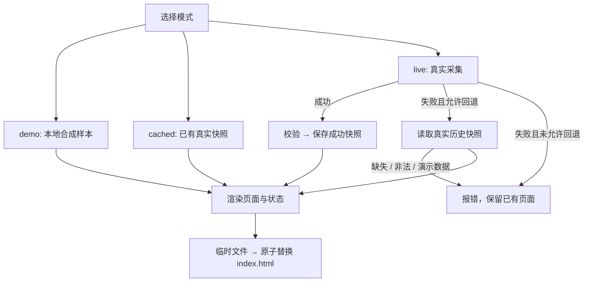

# 框架设计

## 设计目标

以尽量少的基础设施完成“数据 → 可解释研究候选 → 可发布页面 → 可核验结果”。计算在 Python 中完成，浏览器只渲染结果；不需要账户系统、后端 API 或数据库。

## 模块职责

| 模块 | 输入 | 输出 / 责任 |
| --- | --- | --- |
| `a_share_quant_scan.py` | 行情、财报、K 线、配置 | 过滤、因子评分、风险乘数、Top20、研究 CSV |
| `planning.py` | 单个候选的均线、ATR、收益等 | 短期与长期启发式价格区间 |
| `refresh.py` | 模式、合成示例或真实采集结果 | 快照校验、缓存、HTML、run.json |
| `site_template.html` | 转义后的候选 JSON 与状态 | 响应式静态展示 |
| `scripts/run_refresh_and_deploy.sh` | 环境变量、命令行参数 | 每次隔离产物、可选 SSH 原子发布 |
| `scripts/verify_site.py` | URL、可选本地产物 | 200、必需链接、字节级一致性 |
| `scripts/export_run_history.py` | 本地原始日志 | 白名单字段的公开记录与汇总 |

## 运行状态机

只有真实采集成功能覆盖 `var/last_success.json`。demo 不写真实缓存；fallback 沿用原数据日期。HTML 与 run.json 分别原子写入，但两者不是跨文件事务。当前版本按单任务运行设计，同时运行多个进程需在调度层加锁。

## 五因子流程

1. 东方财富行情按页读取。检查分页总量与唯一证券数；空页、重复或数量不一致直接失败。排序发生变化时这项检查可能拒绝一轮采集，但不会把明显残缺快照当成完整结果。
2. 用 AKShare 读取显式配置的报告期，以及相隔三年的年度报表。沿用内部 q1 / 2025 / 2022 字段名作为兼容名称，语义由环境配置决定。
3. 基础过滤：价格、PE、PB、利润为正；成交额至少 1 亿元；剔除 ST、退市标记和名称以 N/C 开头的证券；要求关键财务值存在。
4. 单因子做 1% / 99% 分位裁剪，再排名为百分位。缺失值的处理随组内均值规则；最终分数缺失会被快照校验阻止发布。
5. 预排序前 1,200 个候选请求历史 K 线。至少 75 根有效记录，计算 5/10/20/60 日均线、20/60 日收益、ATR14、连涨天数与 20 日平均成交额。
6. 最终分数 = 0.16×估值 + 0.22×成长 + 0.17×质量 + 0.25×动量 + 0.20×资金，再乘风险系数。
7. ATR14% > 8 / > 10、连涨 > 5 天、20 日收益 > 50% 时分别乘 0.92 / 0.90 / 0.90 / 0.94。条件可以叠加。
8. 按行业最多 3 个证券选 Top20，再按用户排除名单取 Top10。没有行业中性化、优化器或持仓资金分配。

## 快照与时间

`schema_version=1`；记录 source、data_as_of、stocks，真实采集另含 fetched_at、report_period、annual_year 与市场汇总。data_as_of 使用所选候选中最早的最后一根 K 线日期。它是候选历史数据的保守日期，不是所有上游来源同步完成的保证。

运行产物另记 generated_at、mode、candidate_count、upstream_error_type。时区明确为 Asia/Shanghai。脱敏状态只保留异常类型；底层详细异常可能出现在私人终端日志中。

## 部署取舍

静态文件便于 CDN / Nginx / 对象存储托管，失败时保留旧页面。SSH 脚本先上传临时文件，再远端 mv；要求已有 known_hosts 与已配置的目标目录。发布后校验完整 HTML 是否与本地产物一致，避免 HTTP 200 实际返回旧页面。

没有队列、数据库、交易执行服务或自动重试调度平台。复杂系统留给有证据的下一阶段需要。
